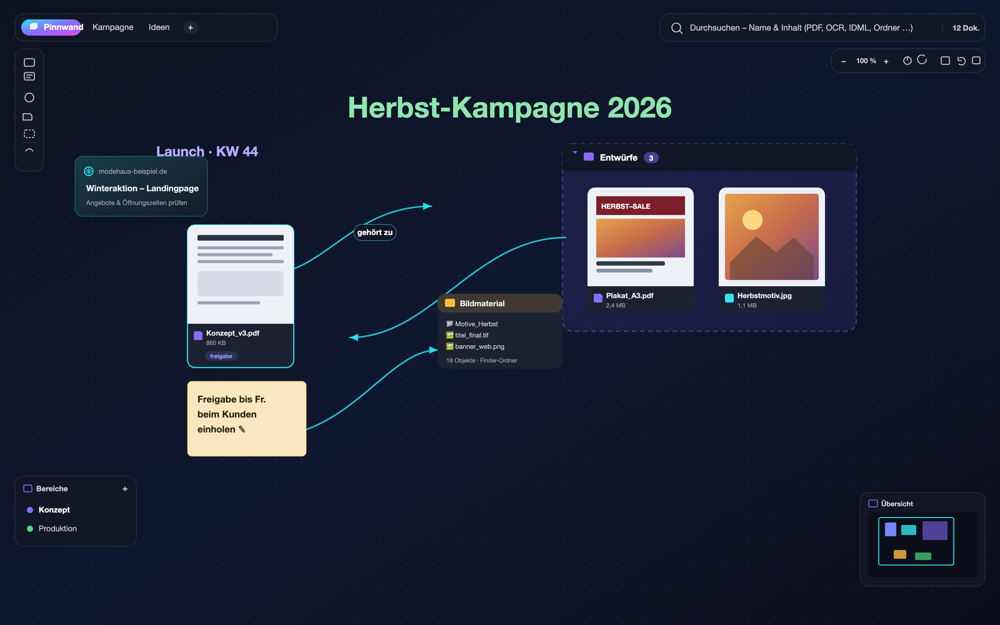

# Fundus

**Eine native macOS-App, die Dokumente als freie Pinnwand sammelt – ohne sie zu kopieren.**

Fundus legt Dateien als Karten auf eine unendliche Leinwand. Dabei wird **nie eine Kopie
angelegt**: Fundus merkt sich nur den Pfad (plus ein Datei-Lesezeichen, das Verschieben und
Umbenennen übersteht) und macht den **Inhalt durchsuchbar** – inklusive PDF-Text, OCR von
Scans, IDML/InDesign-Text und Office-Dokumenten. So entsteht ein visueller, durchsuchbarer
Überblick über verstreute Projektdateien, der die Originale an ihrem Ort belässt.

> Rein lokal. Kein Konto, kein Server, keine Telemetrie. Alles bleibt auf dem Mac.

<p align="center"></p>

<p align="center"><sub>Beispielansicht mit Platzhalter-Inhalten.</sub></p>

<p align="center"><a href="https://github.com/danielwbittner-hub/Fundus/releases/latest"><b>⬇ Neueste Version herunterladen (.dmg)</b></a></p>

---

## Funktionen

**Erfassen**
- Dateien, ganze **Finder-Ordner** (zeigen ihren Inhalt, werden indexiert) und **Website-Links**
  per Drag & Drop oder ⌘V ablegen – oder von überall per macOS-Dienst „**An Fundus senden**".
- Links holen automatisch Titel und Favicon; eingefügte Bilder/Screenshots werden als Karte gesichert.
- **Vorschauen** für PDF, Bilder (inkl. PSD/TIFF/SVG), Office und mehr über QuickLook. Für **INDD**
  nutzt Fundus automatisch eine gleichnamige PDF daneben (gestochen scharf) bzw. die eingebettete
  Vorschau; auf Wunsch rendert es per InDesign eine echte Seitenvorschau. **Affinity**-Dateien
  zeigen ihre eingebettete Vorschau.

**Finden**
- Volltextsuche über Name **und** Inhalt (FTS5): PDF-Text, OCR, IDML, SVG-Text, Ordnerinhalte, Tags.
- **⌘K-Schnellsuche** über **alle Leinwände** hinweg – springt direkt zum Treffer.
- **Schlagworte (Tags)** je Karte, als Filter anklickbar.

**Ordnen**
- **Mappen** (Container, die Karten mitnehmen und sich ein-/ausklappen lassen) und übergeordnete
  **Bereiche** mit vertikaler Navigation.
- Mehrfachauswahl (Rahmen ziehen oder ⇧-Klick) → **Ausrichten, Verteilen, am Raster einrasten,
  als Gitter anordnen, in eine Mappe fassen**.
- **Textfelder, farbige Notizzettel**, Verbindungslinien mit **Beschriftung**, Überschriften-Stile.

**Verlässlich**
- **Datei-Lesezeichen** heilen verschobene/umbenannte Dateien automatisch.
- **Gesundheits-Check**: fehlende Dateien, tote Web-Links und Dubletten auf einen Blick.
- **Automatische Sicherung** der Datenbank auf ein externes oder Netzlaufwerk (alle 2 Tage; zusätzlich
  wöchentlich ein großes Backup inkl. Vorschauen).

**Teilen**
- Karte per Drag in den **Finder** oder andere Apps ziehen.
- Leinwand als **PNG/PDF** exportieren, als **Paket** (Dateien + Manifest) weitergeben oder **drucken**.

**Ansicht**
- Mehrere **Leinwände** als Reiter, **Mini-Karte** zur Navigation, **Hell/Dunkel**-Umschalter,
  ⌘-Scroll-Zoom, frei belegbare **Tastaturbefehle**.

---

## Installation

Fertige App: die neueste `Fundus-<Version>.dmg` von der
**[Releases-Seite](https://github.com/danielwbittner-hub/Fundus/releases/latest)** laden, öffnen,
**Fundus** in den Programme-Ordner ziehen, starten. Beim ersten Start einen **Datenbank-Ordner** wählen – gern in einer Cloud (Nextcloud,
iCloud Drive …), damit die Sammlung eine Neuinstallation übersteht. Dort legt Fundus `Fundus.db`
samt Vorschau-Ordnern an; die Originaldateien bleiben, wo sie sind.

Die App ist **ad-hoc signiert** (kostenlose Apple-ID). Beim ersten Start ggf. per Rechtsklick →
„Öffnen" bestätigen.

---

## Aus dem Quellcode bauen

Voraussetzungen: macOS 14+, **Xcode 16+** und **[XcodeGen](https://github.com/yonaskolb/XcodeGen)**
(`brew install xcodegen`). Das Xcode-Projekt wird aus `project.yml` **generiert** und ist nicht
eingecheckt.

```bash
cd Fundus
xcodegen generate          # erzeugt Fundus.xcodeproj aus project.yml
open Fundus.xcodeproj       # in Xcode öffnen und starten (⌘R)
```

Oder per Kommandozeile bauen:

```bash
DEVELOPER_DIR=/Applications/Xcode.app/Contents/Developer \
  xcodebuild -scheme Fundus -destination 'platform=macOS' CODE_SIGNING_ALLOWED=NO build
```

Verteilbare DMG (universal, ad-hoc signiert):

```bash
./build-dmg.command        # erzeugt dist/Fundus-<Version>.dmg
```

> **Wichtig:** Nach dem Hinzufügen neuer `.swift`-Dateien oder Änderungen an `project.yml` immer
> `xcodegen generate` ausführen – sonst findet der Build die neuen Typen nicht.

Im Team/eigene Signatur: in `project.yml` den `DEVELOPMENT_TEAM` anpassen und neu generieren.

---

## Architektur

Native **SwiftUI + AppKit**, Swift 5, Deployment-Target macOS 14. Keine Fremdpakete – alles kommt
aus dem System (inkl. SQLite). Grober Aufbau unter `Fundus/`:

| Ordner          | Inhalt |
|-----------------|--------|
| `App/`          | Einstieg, zentraler Zustand `AppModell` (`@MainActor`), Design/Theme, Tastaturkürzel |
| `Leinwand/`     | Canvas-Darstellung, Karten/Mappen/Bereiche/Notizen, Export-Render |
| `Modell/`       | Datenmodelle (`Eintrag`, `Ordner`, `Notiz`, `Rahmen`, `Verbindung` …) |
| `Speicher/`     | SQLite-Wrapper `Datenbank`, Akteur `Ablage`, Backup, Datei-Lesezeichen, Export-Paket |
| `Indizierung/`  | Vorschauen, Textauszug (PDF/OCR/IDML/Office/SVG), Ordner- und Web-Erfassung |
| `UI/`           | Einstellungen, Schnellsuche, Gesundheits-Check, Inspektor, Mini-Karte |

**Datenhaltung.** Eine SQLite-Datei mit FTS5-Volltextindex. Alle Zugriffe laufen über den Akteur
`Ablage` (thread-sicher); schwere Arbeit (Vorschau, OCR, Dateiprüfung) läuft gedrosselt im
Hintergrund. WAL-Modus; vor Backup/Beenden wird per `wal_checkpoint(TRUNCATE)` eine konsistente
Einzeldatei geschrieben (Cloud-freundlich). **Nicht an zwei Rechnern gleichzeitig öffnen.**

**Referenz statt Kopie.** Dateien werden per absolutem Pfad referenziert; zusätzlich wird ein
Security-Scoped Bookmark gespeichert, damit Referenzen Verschieben/Umbenennen überstehen.

---

## Datenschutz & Sicherheit

- **Rein lokal**: kein Konto, kein Server, keine Analyse/Telemetrie.
- **Netzzugriff nur** beim Hinterlegen eines Website-Links bzw. beim Gesundheits-Check – und nur auf
  die **vom Nutzer eingegebene Adresse** (nur `http`/`https`), mit **generischem User-Agent** ohne
  persönliche Daten und begrenzter Download-Größe.
- Externe Prozesse (`unzip`, InDesign-Export) laufen mit **Zeitlimit**; Datei-Parser mit
  **Größengrenzen** (Schutz gegen aufgeblähte/kaputte Dateien).
- Backups kopieren ausschließlich die Datenbank und Vorschauen an den selbst gewählten Zielort.

---

## Unterstützte Dateien (Vorschau & Volltext)

PDF (Text + OCR bei Scans), Bilder (PNG/JPEG/HEIC/TIFF/PSD/SVG/WebP …), InDesign (INDD via Sidecar-PDF/
eingebettete bzw. InDesign-gerenderte Vorschau), IDML (Volltext), Office (DOCX/PPTX/XLSX, Text),
Affinity (eingebettete Vorschau), Klartext/Markdown/HTML/RTF u. a. Nicht jedes Format liefert auf jedem
Mac eine Vorschau (QuickLook-abhängig); dann zeigt Fundus ein Typ-Symbol.

---

## Tastaturbefehle (Auswahl, frei belegbar)

| Aktion | Standard |
|--------|----------|
| Schnell finden (alle Leinwände) | ⌘K |
| Textfeld / Notizzettel / Link / Mappe / Bereich | ⌘T / ⇧⌘T / ⌘L / ⇧⌘O / ⇧⌘B |
| Verbinden | ⌘U |
| Neue Leinwand | ⌘N |
| Alles einpassen / Zoom zurücksetzen | ⌘0 / ⇧⌘0 |
| Exportieren (Bild/PDF) / Drucken | ⌘E / ⇧⌘E / ⌘P |
| Gesundheits-Check / Tastaturbefehle | ⇧⌘J / ⌘/ |

**Maus & Trackpad:** Leinwand schwenken = **Leertaste halten + ziehen**, Bereich verschieben =
**⌥ halten + ziehen**, Zoomen = **⌘ + Scrollrad**, Mehrfachauswahl = **⇧-Klick** oder auf leerer
Fläche ziehen, Schnellvorschau = **Leertaste** antippen.

---

## Lizenz

Siehe [LICENSE](LICENSE).
